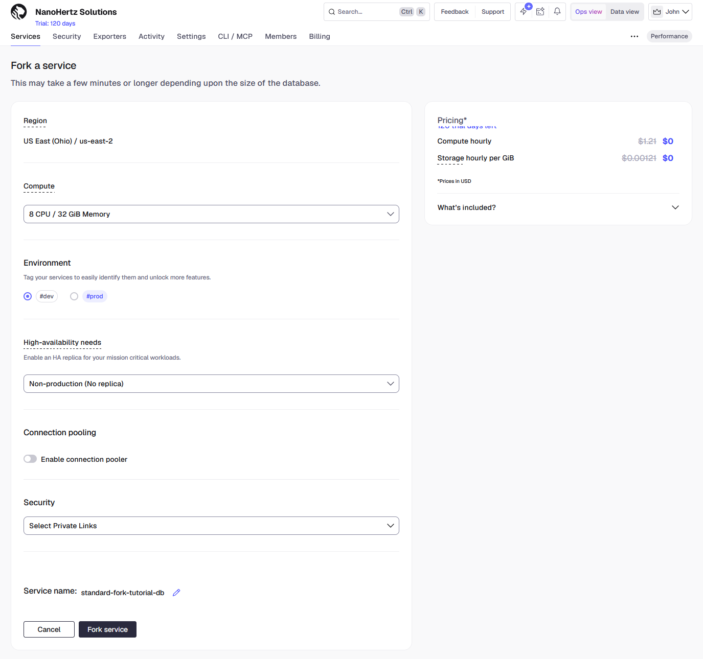
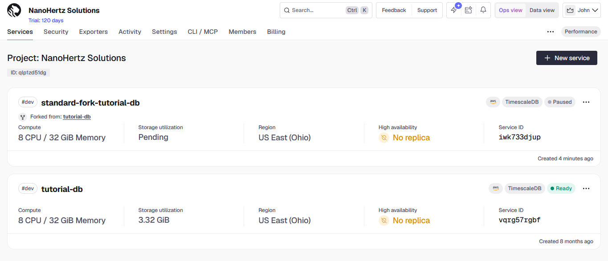
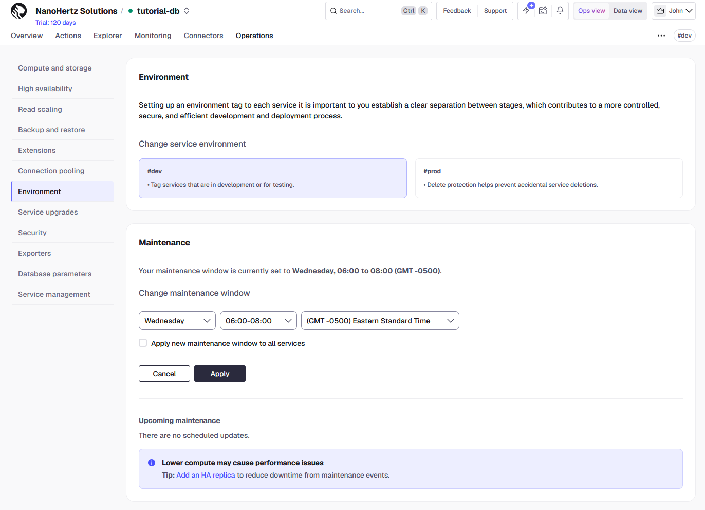

import { NumberedList, NumberedItem } from "@components/NumberedList";

This tutorial shows you how to upgrade a Tiger Cloud service from PostgreSQL 17 to 18. You will plan the version path, run a pre-flight checklist, rehearse the upgrade on a fork and measure its unavailable window, verify the fork, then upgrade production and verify it the same way. A separate section covers the same upgrade on a self-hosted installation with `pg_upgrade` and in Docker. By the end, you'll have a pre-flight script, a runbook, and a verification query to reuse for your next upgrade.

If you want an overview of how Tiger Cloud handles maintenance first, see [Maintenance and upgrades](https://www.tigerdata.com/docs/deploy/tiger-cloud/tiger-cloud-aws/upgrades).

## What you learn

- How to plan an upgrade path that keeps TimescaleDB compatible with PostgreSQL at every step.
- How to rehearse the upgrade on a fork of your service and read the fork's unavailable window as the estimate for production.
- How to verify extensions, policies, continuous aggregates, and jobs after the upgrade, on Tiger Cloud and on a self-hosted installation.
- Which signals mean stop and contact Support, and how to roll back to the service you had before.

## Prepare the service

<NumberedList>
<NumberedItem title="Start from a Tiger Cloud service on PostgreSQL 17 or earlier">

New services come with the newest PostgreSQL major version by default, so you must start with an existing service. Check whether you can upgrade your service by opening it in Tiger Console and clicking `Operations` > `Service upgrades`. The page shows the current and latest version of PostgreSQL and of TimescaleDB, and an `Upgrade service` button when a newer PostgreSQL version is available.

> **Note:** You can also follow this tutorial with a self-hosted TimescaleDB installation on PostgreSQL 17. Follow the setup, planning, and pre-flight sections here, then continue in [Upgrade a self-hosted instance](#upgrade-a-self-hosted-instance).

</NumberedItem>
<NumberedItem title="Connect to your service">

Save your connection string in the `DATABASE_URL` environment variable and connect with these commands.

```bash
export DATABASE_URL="<connection string>"
psql "$DATABASE_URL"
```

Later scripts rely on `DATABASE_URL` to run properly.

</NumberedItem>
<NumberedItem title="Check what the service already holds">

List the extensions, the policy jobs, and the hypertables by running this SQL.

```sql
\dx

SELECT job_id, application_name, hypertable_name
FROM timescaledb_information.jobs
WHERE job_id >= 1000
ORDER BY job_id;

SELECT hypertable_name, num_chunks
FROM timescaledb_information.hypertables
ORDER BY hypertable_name;
```

If the output shows a hypertable with chunks, at least one policy job, and a continuous aggregate, skip ahead to [Fork the service](#fork-the-service). If the service is empty, load the sample dataset first.

</NumberedItem>
</NumberedList>

### Load the sample dataset

Follow these steps on a test service that has no hypertable, continuous aggregate, or policies. Skip this subsection if you're using a production service.

<NumberedList>
<NumberedItem title="Create the hypertable">

Create the `sensor_data` hypertable by running this SQL in your `psql` session.

```sql
CREATE TABLE sensor_data (
    reading_id  bigint NOT NULL,
    time        timestamptz NOT NULL,
    device_id   text NOT NULL,
    tag         text NOT NULL,
    value       double precision,
    unit        text,
    description text
) WITH (
    tsdb.hypertable,
    tsdb.partition_column = 'time',
    tsdb.chunk_interval = '7 days',
    tsdb.columnstore = false
);

CREATE INDEX sensor_data_device_tag_time_idx
    ON sensor_data (device_id, tag, time DESC);
```

The table uses weekly chunks and has an index for queries that filter on a machine, a sensor, and a time range. The columnstore stays off until Step 3, so no background job converts chunks while the loading script runs.

</NumberedItem>
<NumberedItem title="Load the manufacturing dataset">

Type `\q` to quit `psql`. Stay in the same terminal, so `DATABASE_URL` keeps its value, and download `manufacturing.zip`.

Unzip the dataset and install `psycopg`, the PostgreSQL driver for Python, by running these commands:

```bash
unzip manufacturing.zip
pip install "psycopg[binary]"
```

Save this script as `load_data.py` and run it in the same directory. It may take a minute or two, depending on your internet connection.

```python
"""
Load manufacturing.csv into the sensor_data hypertable.

The script numbers each reading in file order, which is time order,
and shifts every timestamp forward so the newest reading falls in
the current hour.
"""
import csv
import os
import sys
from datetime import datetime, timezone
from pathlib import Path

import psycopg

CSV_PATH = Path(__file__).resolve().parent / "manufacturing.csv"
COPY_SQL = """
    COPY sensor_data
        (reading_id, time, device_id, tag, value, unit, description)
    FROM STDIN
"""


def read_rows():
    with CSV_PATH.open(newline="", encoding="utf-8") as f:
        yield from csv.DictReader(f)


def main():
    url = os.environ.get("DATABASE_URL")
    if not url:
        sys.exit("Set DATABASE_URL to your service connection string.")
    if not CSV_PATH.exists():
        sys.exit(f"Can't find {CSV_PATH}. Unzip manufacturing.zip first.")

    print("Finding the newest reading in the file...")
    newest = max(datetime.fromisoformat(r["time"]) for r in read_rows())
    this_hour = datetime.now(timezone.utc).replace(
        minute=0, second=0, microsecond=0
    )
    shift = this_hour - newest
    print(f"Shifting timestamps forward by {shift.days} days.")

    with psycopg.connect(url) as conn:
        with conn.cursor() as cur:
            cur.execute("SELECT count(*) FROM sensor_data")
            if cur.fetchone()[0] > 0:
                sys.exit("sensor_data already has rows. Nothing loaded.")

            with cur.copy(COPY_SQL) as copy:
                for reading_id, r in enumerate(read_rows(), start=1):
                    copy.write_row((
                        reading_id,
                        datetime.fromisoformat(r["time"]) + shift,
                        r["device_id"],
                        r["tag"],
                        r["value"],
                        r["unit"],
                        r["description"],
                    ))
                    if reading_id % 500_000 == 0:
                        print(f"Sent {reading_id:,} rows...")

    print(f"Loaded {reading_id:,} rows into sensor_data.")


if __name__ == "__main__":
    main()
```

The loading script does three things:

- It reads the file once to find the newest reading, then shifts every timestamp forward by the same amount so the newest reading falls in the current hour. The shift puts the newest week of readings in a chunk the columnstore policy leaves alone, and gives the continuous aggregate recent data to refresh.
- It numbers the readings in the order they appear in the file, which is time order, and stores the number in `reading_id`.
- It streams the rows into `sensor_data` with the PostgreSQL `COPY` command, which is much faster than inserting rows one at a time.

Verify the script loaded about 4.4 million rows into the table.

```
Finding the newest reading in the file...
Shifting timestamps forward by 62 days.
Sent 500,000 rows...
Sent 1,000,000 rows...
Sent 1,500,000 rows...
Sent 2,000,000 rows...
Sent 2,500,000 rows...
Sent 3,000,000 rows...
Sent 3,500,000 rows...
Sent 4,000,000 rows...
Loaded 4,380,050 rows into sensor_data.
```

</NumberedItem>
<NumberedItem title="Add a continuous aggregate and three policies">

Reconnect with `psql`. Update the planner statistics, create a daily continuous aggregate, and add a policy that refreshes the most recent 30 days every hour by running this SQL.

```sql
ANALYZE sensor_data;

CREATE MATERIALIZED VIEW sensor_data_daily
WITH (timescaledb.continuous) AS
SELECT time_bucket('1 day', time) AS day,
       device_id,
       tag,
       avg(value) AS avg_value,
       min(value) AS min_value,
       max(value) AS max_value
FROM sensor_data
GROUP BY day, device_id, tag
WITH NO DATA;

SELECT add_continuous_aggregate_policy('sensor_data_daily',
    start_offset      => INTERVAL '30 days',
    end_offset        => INTERVAL '1 hour',
    schedule_interval => INTERVAL '1 hour');
```

Add a retention policy that drops chunks older than five years, then turn on the columnstore with a policy that converts chunks older than one week by running this SQL.

```sql
SELECT add_retention_policy('sensor_data',
    drop_after => INTERVAL '5 years');

ALTER TABLE sensor_data SET (
    tsdb.enable_columnstore = true,
    tsdb.segmentby = 'device_id, tag',
    tsdb.orderby = 'time DESC'
);

CALL add_columnstore_policy('sensor_data',
    after => INTERVAL '7 days');
```

Run all three jobs once with [`run_job()`](https://www.tigerdata.com/docs/reference/timescaledb/jobs-automation/run_job) by running this SQL. The columnstore job takes a minute or two.

```sql
DO $$
DECLARE
    job int;
BEGIN
    FOR job IN
        SELECT job_id
        FROM timescaledb_information.jobs
        WHERE hypertable_name = 'sensor_data'
           OR hypertable_name = (
               SELECT materialization_hypertable_name
               FROM timescaledb_information.continuous_aggregates
               WHERE view_name = 'sensor_data_daily')
        ORDER BY job_id
    LOOP
        CALL run_job(job);
    END LOOP;
END
$$;
```

List the extensions, the jobs, and the chunks by compression state with this SQL.

```sql
\dx

SELECT job_id, application_name, schedule_interval
FROM timescaledb_information.jobs
WHERE job_id >= 1000
ORDER BY job_id;

SELECT is_compressed, count(*) AS chunks
FROM timescaledb_information.chunks
WHERE hypertable_name = 'sensor_data'
GROUP BY is_compressed
ORDER BY is_compressed;
```

Verify that `\dx` lists `timescaledb`, the jobs list shows three policies, and all but the newest one or two chunks are compressed.

```
                                                         List of installed extensions
    Name     | Version | Default version |   Schema   |                                      Description
-------------+---------+-----------------+------------+---------------------------------------------------------------------------------------
 plpgsql     | 1.0     | 1.0             | pg_catalog | PL/pgSQL procedural language
 timescaledb | 2.31.0  | 2.31.0          | public     | Enables scalable inserts and complex queries for time-series data (Community Edition)

 job_id |              application_name              | schedule_interval
--------+--------------------------------------------+-------------------
   1000 | Refresh Continuous Aggregate Policy [1000] | 01:00:00
   1001 | Retention Policy [1001]                    | 1 day
   1002 | Columnstore Policy [1002]                  | 12:00:00

 is_compressed | chunks
---------------+--------
 f             |      2
 t             |    259
```

</NumberedItem>
</NumberedList>

### Fork the service

In Tiger Console, open the service and click `Operations` > `Service management` > `Fork service`. On the `Fork a service` page, leave `Compute` at the service's own size so the fork's upgrade time predicts production, give the fork a name such as `practice-fork` under `Service name`, and click `Fork service`. A fork takes several minutes and appears in `Services` with a `Forked from` label and the status `Ready` when it is done.



Download the fork's configuration file and save its connection string with this command.

```bash
export FORK_URL="<fork connection string>"
```

Every step from here to [Upgrade production](#upgrade-production) runs against the fork.

## Plan the version path

A version path is the sequence of PostgreSQL steps and TimescaleDB steps that keeps the two compatible throughout.

<NumberedList>
<NumberedItem title="Record the versions you start from">

Show the PostgreSQL and TimescaleDB versions on the fork by running this command.

```bash
psql "$FORK_URL" -At -c "SHOW server_version;" -c "SELECT extversion FROM pg_extension WHERE extname = 'timescaledb';"
```

Verify the output shows a PostgreSQL 17 minor version and a TimescaleDB version.

```
17.11
2.31.0
```

</NumberedItem>
<NumberedItem title="Read the support matrix">

Open the support matrix on the [Upgrade PostgreSQL](https://www.tigerdata.com/docs/self-hosted/latest/upgrades/upgrade-pg) page and find your TimescaleDB version's row. If it supports both the PostgreSQL version you run and the one you want, your path is one PostgreSQL step. Every current TimescaleDB release supports PostgreSQL 16, 17, and 18, so 17 to 18 takes one step.

If your TimescaleDB version has no build for the target, the path has three steps: update TimescaleDB to the last release that supports your current PostgreSQL version, upgrade PostgreSQL, then update TimescaleDB again. TimescaleDB 2.28 is the last release that supports PostgreSQL 15, so a service on 15 follows this shape.

The TimescaleDB version stays identical across a PostgreSQL step, on Tiger Cloud and self-hosted alike, because the new server has to load the exact extension version the old catalog names.

</NumberedItem>
<NumberedItem title="Start the runbook">

Save this file as `upgrade-runbook.md` and fill in the first heading.

```markdown
# PostgreSQL upgrade runbook

## Version path

| Step | From | To |
|---|---|---|
| 1 | PostgreSQL 17, TimescaleDB 2.31.0 | PostgreSQL 18, TimescaleDB 2.31.0 |

## Rollback point

## Maintenance window

## Measured timing
```

Verify your runbook lists each step of your path as a pair of versions, with the TimescaleDB version unchanged across every PostgreSQL step.

</NumberedItem>
</NumberedList>

## Run the pre-flight checklist

<NumberedList>
<NumberedItem title="Save the pre-flight script">

Save this script as `preflight.sql`.

```sql
-- preflight.sql: inventory a TimescaleDB database before and after
-- a PostgreSQL major upgrade.
--
-- psql "$DATABASE_URL" -f preflight.sql -o preflight-before.txt

\pset footer off

\qecho == Server version
SHOW server_version;

\qecho == Extensions
SELECT extname, extversion
FROM pg_extension
ORDER BY extname;

\qecho == Jobs and settings
SELECT job_id, application_name, proc_name,
       schedule_interval, scheduled, config
FROM timescaledb_information.jobs
WHERE job_id >= 1000
ORDER BY job_id;

\qecho == Job status
SELECT job_id, job_status, last_run_status,
       total_failures, last_run_started_at
FROM timescaledb_information.job_stats
WHERE job_id >= 1000
ORDER BY job_id;

\qecho == Newest bucket in each continuous aggregate
SELECT string_agg(
         format('SELECT %L AS continuous_aggregate, '
                'max(%I) AS newest_bucket FROM %I.%I',
                ca.view_name, d.column_name,
                ca.view_schema, ca.view_name),
         ' UNION ALL ' ORDER BY ca.view_name)
FROM timescaledb_information.continuous_aggregates AS ca
JOIN timescaledb_information.dimensions AS d
  ON d.hypertable_schema = ca.materialization_hypertable_schema
 AND d.hypertable_name = ca.materialization_hypertable_name
WHERE d.dimension_number = 1
\gexec

\qecho == Chunks by compression state
SELECT hypertable_name, is_compressed, count(*) AS chunks
FROM timescaledb_information.chunks
GROUP BY hypertable_name, is_compressed
ORDER BY hypertable_name, is_compressed;

\qecho == Rows in each hypertable
SELECT string_agg(
         format('SELECT %L AS hypertable, count(*) AS rows FROM %I.%I',
                hypertable_name, hypertable_schema, hypertable_name),
         ' UNION ALL ' ORDER BY hypertable_name)
FROM timescaledb_information.hypertables
\gexec

\qecho == Tables with planner statistics
SELECT schemaname, count(DISTINCT tablename) AS tables_with_statistics
FROM pg_stats
WHERE schemaname NOT IN ('pg_catalog', 'information_schema')
GROUP BY schemaname
ORDER BY schemaname;

\qecho == Relations
SELECT count(*) AS relations
FROM pg_class
WHERE relnamespace::regnamespace::text
      NOT IN ('pg_catalog', 'information_schema', 'pg_toast');
```

The script records everything the upgrade could change. The two `\gexec` blocks build a query that covers every continuous aggregate and every hypertable, so it needs no edits for your own schema.

</NumberedItem>
<NumberedItem title="Run the script against the fork and save the baseline">

Run the script against the fork and write its output to a file with this command.

```bash
psql "$FORK_URL" -f preflight.sql -o preflight-before.txt
```

Compare `preflight-before.txt` with this example, which is trimmed to the first three sections.

```
== Server version
 server_version
----------------
 17.11

== Extensions
   extname   | extversion
-------------+------------
 plpgsql     | 1.0
 timescaledb | 2.31.0

== Jobs and settings
 job_id |              application_name              |              proc_name              | schedule_interval | scheduled |                                    config
--------+--------------------------------------------+-------------------------------------+-------------------+-----------+-------------------------------------------------------------------------------
   1000 | Refresh Continuous Aggregate Policy [1000] | policy_refresh_continuous_aggregate | 01:00:00          | t         | {"end_offset": "01:00:00", "start_offset": "30 days", "mat_hypertable_id": 2}
   1001 | Retention Policy [1001]                    | policy_retention                    | 1 day             | t         | {"drop_after": "5 years", "hypertable_id": 1}
   1002 | Columnstore Policy [1002]                  | policy_compression                  | 12:00:00          | t         | {"hypertable_id": 1, "compress_after": "7 days"}
...
```

</NumberedItem>
<NumberedItem title="Export the job settings">

Export every job's settings to a comma-separated values (CSV) file by running this command on one line.

```bash
psql "$FORK_URL" -c "\copy (SELECT job_id, application_name, proc_name, schedule_interval, max_runtime, max_retries, retry_period, scheduled, config FROM timescaledb_information.jobs WHERE job_id >= 1000 ORDER BY job_id) TO 'jobs-before.csv' WITH (FORMAT csv, HEADER)"
```

Verify the command prints `COPY` followed by the number of jobs.

```
COPY 3
```

The file holds the settings to recreate a policy if one goes missing.

</NumberedItem>
<NumberedItem title="Check for a running job">

Check for a running job by running this SQL against the fork.

```sql
SELECT job_id, application_name, job_status, last_run_started_at
FROM timescaledb_information.jobs
JOIN timescaledb_information.job_stats USING (job_id)
WHERE job_status = 'Running';

SELECT pid, application_name, state,
       now() - query_start AS running_for
FROM pg_stat_activity
WHERE application_name LIKE '%Policy%';
```

Verify both queries return no rows.

```
 job_id | application_name | job_status | last_run_started_at
--------+------------------+------------+---------------------
(0 rows)

 pid | application_name | state | running_for
-----+------------------+-------+-------------
(0 rows)
```

A job that is running when the server stops starts over after the upgrade, which adds to the first post-upgrade run.

If a columnstore job shows `Running`, wait for it to finish, or pause it with [`alter_job()`](https://www.tigerdata.com/docs/reference/timescaledb/jobs-automation/alter_job) and turn it back on after the upgrade. Replace `1002` with the job's `job_id`.

```sql
SELECT alter_job(1002, scheduled => false);
```

After the upgrade, run `SELECT alter_job(1002, scheduled => true);` to resume it.

</NumberedItem>
<NumberedItem title="Create the rollback fork">

Fork the production service a second time, as in [Fork the service](#fork-the-service), name it `rollback-fork`, and leave it on PostgreSQL 17. When it is `Ready`, open it and click `Operations` > `Service management` > `Pause service`. A paused fork costs storage only and holds your data from before the upgrade, which is what a rollback needs.



Record the rollback fork's name and creation time under `Rollback point` in your runbook.

Verify that `preflight-before.txt` and `jobs-before.csv` exist and that `Services` shows the rollback fork as `Paused`.

</NumberedItem>
</NumberedList>

## Rehearse the upgrade on a fork

<NumberedList>
<NumberedItem title="Note the time and start the upgrade">

Record the current time in Coordinated Universal Time (UTC) by running this command.

```bash
date -u +"%Y-%m-%d %H:%M:%S+00"
```

The verification set uses this time to tell which jobs ran after the upgrade.

Open the practice fork in Tiger Console and click `Operations` > `Service upgrades`, then `Upgrade service`, and confirm.

The service keeps its connection string. If the upgrade fails, the service returns to its previous state.

</NumberedItem>
<NumberedItem title="Watch the upgrade">

The service is unavailable during the upgrade, and a `psql` connection attempt fails until it returns.

> **PENDING CLIENT INPUT: PostgreSQL 17 test service.** The exact connection error `psql` prints during a Console upgrade, and how long the practice fork was unavailable, come from upgrading a Tiger Cloud service that runs PostgreSQL 17. The Console creates new services only on the newest major version, so this run waits for a PostgreSQL 17 service from Tiger Data.

Watch three places in the Console:

- The service's status, which shows the upgrade in progress and then returns to `Ready`.
- The `Logs` tab, which shows the shutdown, the upgrade, and the restart.
- The `Metrics` tab, which shows a gap in every chart while the service is down.

> **PENDING CLIENT INPUT: PostgreSQL 17 test service.** An excerpt of the service logs across the shutdown, the upgrade, and the restart goes here, from the same PostgreSQL 17 run.

</NumberedItem>
<NumberedItem title="Read the duration and record it">

When the status returns to `Ready`, open the `Metrics` tab and read the length of the gap. That gap is your production estimate.

Record it under `Measured timing` in your runbook, with the relation count and chunk count from `preflight-before.txt`.

Every chunk and chunk index is a catalog entry the upgrade rebuilds, so the duration follows the relation count more than the data size.

> **PENDING CLIENT INPUT: PostgreSQL 17 test service.** The measured durations for two forks of the same PostgreSQL 17 service, one with the full dataset and one trimmed to a single chunk, go here with their chunk and relation counts, to show how much the relation count matters.

Check the fork's versions by running this command.

```bash
psql "$FORK_URL" -At -c "SHOW server_version;" -c "SELECT extversion FROM pg_extension WHERE extname = 'timescaledb';"
```

Verify the fork runs PostgreSQL 18 with the same TimescaleDB version as before.

```
18.6
2.31.0
```

</NumberedItem>
</NumberedList>

## Verify the fork

<NumberedList>
<NumberedItem title="Run the pre-flight script again and compare">

Run the pre-flight script against the upgraded fork and compare the two files with `diff` by running these commands.

```bash
psql "$FORK_URL" -f preflight.sql -o preflight-after.txt
diff preflight-before.txt preflight-after.txt
```

Verify that the only differences are the server version, the `last_run_started_at` values of jobs that ran since the baseline, and at most the statistics counts of TimescaleDB's internal schemas. This example comes from the self-hosted test run of the same database, before any job ran.

```
2,4c2,4
<            server_version
< ------------------------------------
<  17.11 (Ubuntu 17.11-1.pgdg26.04+2)
---
>           server_version
> ----------------------------------
>  18.6 (Ubuntu 18.6-1.pgdg26.04+2)
46c46,47
<  _timescaledb_internal |                    261
---
>  _timescaledb_catalog  |                      4
>  _timescaledb_internal |                    262
```

Any difference elsewhere is a signal to stop. See [Know when to stop and contact Support](#know-when-to-stop-and-contact-support).

</NumberedItem>
<NumberedItem title="Run every job and check the results">

Save this script as `verify.sql`.

```sql
-- verify.sql: check that every job ran after a PostgreSQL upgrade.
--
-- psql "$DATABASE_URL" -v upgrade_started="2026-11-04 14:00:00+00" \
--      -f verify.sql -o verify-fork.txt

\pset footer off

\qecho == Server and extension versions
SHOW server_version;
SELECT extname, extversion
FROM pg_extension
WHERE extname LIKE 'timescaledb%'
ORDER BY extname;

\qecho == Jobs since the upgrade started
SELECT j.job_id, j.application_name,
       s.last_run_started_at, s.last_run_status,
       CASE
           WHEN s.last_run_started_at >= :'upgrade_started'
                AND s.last_run_status = 'Success' THEN 'ok'
           WHEN s.last_run_started_at >= :'upgrade_started'
                THEN 'FAILED after upgrade'
           ELSE 'NOT RUN since upgrade'
       END AS result
FROM timescaledb_information.jobs AS j
JOIN timescaledb_information.job_stats AS s USING (job_id)
WHERE j.job_id >= 1000
ORDER BY j.job_id;
```

Ask the scheduler to start every job now by running this SQL against the fork.

```sql
SELECT job_id, (alter_job(job_id, next_start => now())).next_start
FROM timescaledb_information.jobs
WHERE job_id >= 1000;
```

Setting `next_start` makes the scheduler run each job within a few seconds and record the run in `job_stats`. `run_job()` runs a job in your own session and leaves `job_stats` untouched, so it can't show that a job ran after the upgrade.

Wait a minute, then run the verification set with the time you recorded before the upgrade.

```bash
psql "$FORK_URL" -v upgrade_started="<time you recorded>" -f verify.sql -o verify-fork.txt
cat verify-fork.txt
```

Verify every job shows `ok`. A job that still shows `NOT RUN since upgrade` has not started yet; wait and run the set again.

```
== Server and extension versions
 server_version
----------------
 18.6

   extname   | extversion
-------------+------------
 timescaledb | 2.31.0

== Jobs since the upgrade started
 job_id |              application_name              |      last_run_started_at      | last_run_status | result
--------+--------------------------------------------+-------------------------------+-----------------+--------
   1000 | Refresh Continuous Aggregate Policy [1000] | 2026-10-28 21:20:45.810752+00 | Success         | ok
   1001 | Retention Policy [1001]                    | 2026-10-28 21:20:45.814598+00 | Success         | ok
   1002 | Columnstore Policy [1002]                  | 2026-10-28 21:20:45.81671+00  | Success         | ok
```

If a job shows `FAILED after upgrade`, run it on its own with `CALL run_job(<job_id>);` and read the error. A second failure signals that you should contact Support.

</NumberedItem>
<NumberedItem title="Check the planner statistics">

Compare the `Tables with planner statistics` section in `preflight-before.txt` and `preflight-after.txt`. A table without statistics gets poor query plans until `ANALYZE` runs. PostgreSQL 18's `pg_upgrade` carries table statistics across, and the self-hosted test run kept them. If a count dropped, run `ANALYZE;` against the fork.

</NumberedItem>
<NumberedItem title="Compare a query plan with production">

Run [`EXPLAIN (ANALYZE, BUFFERS)`](https://www.postgresql.org/docs/current/sql-explain.html) on a one-day query by running this SQL in a `psql` session connected to the fork.

```sql
SELECT date_trunc('day', now(), 'UTC') - INTERVAL '1 day'
           AS yesterday_start,
       date_trunc('day', now(), 'UTC') AS today_start
\gset

EXPLAIN (ANALYZE, BUFFERS)
SELECT device_id, avg(value)
FROM sensor_data
WHERE tag = 'temperature'
  AND time >= :'yesterday_start'
  AND time <  :'today_start'
GROUP BY device_id;
```

Open a second session with `psql "$DATABASE_URL"`, connected to production on PostgreSQL 17, and run the same block.

Compare the number of chunk lines (the lines that name a `_hyper_` chunk) and the scan type on each. PostgreSQL 18 adds an `Index Searches` line and prints row counts with decimals, so the surrounding text differs.

Verify both plans read one chunk with the same scan type. A plan that reads more chunks or switches to a sequential scan after the upgrade is a regression to fix before production. This example comes from a PostgreSQL 18 service with the same dataset; the PostgreSQL 17 plan has the same chunk line and scan type without the `Index Searches` line.

```
 HashAggregate  (cost=52.33..52.39 rows=5 width=17) (actual time=0.341..0.342 rows=5.00 loops=1)
   Group Key: _hyper_49_14699_chunk.device_id
   Batches: 1  Memory Usage: 32kB
   Buffers: shared hit=43
   ->  Index Scan using _hyper_49_14699_chunk_sensor_data_time_idx on _hyper_49_14699_chunk  (cost=0.29..51.72 rows=122 width=17) (actual time=0.060..0.314 rows=120.00 loops=1)
         Index Cond: (("time" >= '2026-10-27 00:00:00+00'::timestamp with time zone) AND ("time" < '2026-10-28 00:00:00+00'::timestamp with time zone))
         Filter: (tag = 'temperature'::text)
         Rows Removed by Filter: 1080
         Index Searches: 1
         Buffers: shared hit=43
 Planning:
   Buffers: shared hit=902
 Planning Time: 2.264 ms
 Execution Time: 0.407 ms
```

</NumberedItem>
</NumberedList>

## Upgrade production

<NumberedList>
<NumberedItem title="Set the maintenance window">

Open the production service and click `Operations` > `Environment`. Under `Maintenance`, choose a day, a two-hour time range in a low-traffic period, and a time zone, and click `Apply`. Tiger Cloud uses this window for its own maintenance, including the automatic upgrade of a deprecated PostgreSQL version once the deadline in its deprecation email passes, and lists anything scheduled under `Upcoming maintenance`. A quiet window limits the downtime if you miss that deadline.



Plan your own upgrade based on the fork's duration. If the service has a high availability (HA) replica or read replicas, add several hours for the rebuild. Record the window under `Maintenance window` in your runbook.

</NumberedItem>
<NumberedItem title="Run the pre-flight checks on production">

Run the pre-flight script, job export, and running-job check against production with these commands.

```bash
psql "$DATABASE_URL" -f preflight.sql -o preflight-production-before.txt
psql "$DATABASE_URL" -c "\copy (SELECT job_id, application_name, proc_name, schedule_interval, max_runtime, max_retries, retry_period, scheduled, config FROM timescaledb_information.jobs WHERE job_id >= 1000 ORDER BY job_id) TO 'jobs-production-before.csv' WITH (FORMAT csv, HEADER)"
psql "$DATABASE_URL" -c "SELECT job_id, job_status FROM timescaledb_information.job_stats WHERE job_status = 'Running';"
```

Verify the running-job query returns no rows, and the rollback fork shows as paused, then record the time with `date -u`.

</NumberedItem>
<NumberedItem title="Start the upgrade">

Click `Operations` > `Service upgrades` > `Upgrade service` on the production service and confirm.

Tiger Cloud removes HA and read replicas during the upgrade, then rebuilds them from the upgraded primary. The rebuild can take several hours, and the replica connection strings stay the same.

</NumberedItem>
<NumberedItem title="Update firewall allowlists">

Look up the service's address by running this command with the host from your connection string.

```bash
nslookup <host>
```

The service keeps its DNS name, but its IP address often changes. If a firewall rule allows the old address, update it. A rule that names the DNS name needs no change.

</NumberedItem>
<NumberedItem title="Verify production">

Run the pre-flight script against the upgraded service and compare it with its baseline. Ask the scheduler to start every job, wait a minute, then run the verification set with these commands.

```bash
psql "$DATABASE_URL" -f preflight.sql -o preflight-production-after.txt
diff preflight-production-before.txt preflight-production-after.txt
psql "$DATABASE_URL" -c "SELECT job_id, (alter_job(job_id, next_start => now())).next_start FROM timescaledb_information.jobs WHERE job_id >= 1000;"
sleep 60
psql "$DATABASE_URL" -v upgrade_started="<time you recorded>" -f verify.sql -o verify-production.txt
diff verify-fork.txt verify-production.txt
```

Verify that the first `diff` shows only the server version and job run times, the second only timestamps, the application reconnects, and any replicas rebuild. Record the duration under `Measured timing` in your runbook.

</NumberedItem>
<NumberedItem title="Clean up the forks">

Delete the practice fork with `Operations` > `Service management` > `Delete service`, and type `DELETE` to confirm. Keep the rollback fork paused until the application has run a full workload cycle on PostgreSQL 18, then delete it too.

</NumberedItem>
</NumberedList>

## Upgrade a self-hosted instance

Follow [Plan the version path](#plan-the-version-path) and [Run the pre-flight checklist](#run-the-pre-flight-checklist) first, with `DATABASE_URL` pointing at your own server. The commands use the paths of the Debian and Ubuntu packages; adjust them for your distribution.

<NumberedList>
<NumberedItem title="Back up the database">

Take a filesystem snapshot of the data directory while the server is stopped, or take a logical backup with this command.

```bash
pg_dump -Fc -f before-upgrade.dump "$DATABASE_URL"
```

</NumberedItem>
<NumberedItem title="Install PostgreSQL 18 and the same TimescaleDB version">

Run this command to show the TimescaleDB version and the data checksum setting on the old server.

```bash
psql "$DATABASE_URL" -At -c "SELECT extversion FROM pg_extension WHERE extname = 'timescaledb';" -c "SHOW data_checksums;"
```

Verify the output shows the version and the checksum setting, which is `off` on a cluster created with default settings before PostgreSQL 18.

```
2.31.0
off
```

The new cluster has to match both.

Install PostgreSQL 18 and the TimescaleDB packages for it, pinned to that version, by running this command. Replace `2.31.0` with your version.

```bash
sudo apt install postgresql-18 \
    timescaledb-2-postgresql-18='2.31.0*' \
    timescaledb-2-loader-postgresql-18='2.31.0*'
```

List the clusters, and create an empty version 18 cluster if the packages didn't, by running these commands. Pass `--no-data-checksums` when the old cluster reported `off`.

```bash
pg_lsclusters
sudo pg_createcluster 18 main -- --no-data-checksums
```

Verify that `pg_lsclusters` now shows the old cluster online and the new one down on the next port.

```
Ver Cluster Port Status Owner    Data directory              Log file
17  main    5432 online postgres /var/lib/postgresql/17/main /var/log/postgresql/postgresql-17-main.log
18  main    5433 down   postgres /var/lib/postgresql/18/main /var/log/postgresql/postgresql-18-main.log
```

PostgreSQL 18's `initdb` turns data checksums on by default, and `pg_upgrade` refuses to move a cluster between different checksum settings. If the packages created an `18 main` cluster already, stop it with `sudo systemctl stop postgresql@18-main`, and drop it with `sudo pg_dropcluster 18 main` before the `pg_createcluster` command if its checksum setting differs from the old cluster's. To gain checksums during the upgrade, stop the old cluster, run `pg_checksums --enable` on its data directory, which rewrites every data file, and create the new cluster with the default settings.

Set `shared_preload_libraries` in the new cluster's configuration file by running this command.

```bash
sudo sed -i "s/^#*shared_preload_libraries.*/shared_preload_libraries = 'timescaledb'/" \
    /etc/postgresql/18/main/postgresql.conf
```

</NumberedItem>
<NumberedItem title="Check the upgrade while the old server runs">

Run `pg_upgrade --check` by running this command.

```bash
cd /tmp && sudo -u postgres /usr/lib/postgresql/18/bin/pg_upgrade \
    --old-bindir  /usr/lib/postgresql/17/bin \
    --new-bindir  /usr/lib/postgresql/18/bin \
    --old-datadir /var/lib/postgresql/17/main \
    --new-datadir /var/lib/postgresql/18/main \
    --old-options '-c config_file=/etc/postgresql/17/main/postgresql.conf' \
    --new-options '-c config_file=/etc/postgresql/18/main/postgresql.conf' \
    --link --check
```

Verify the output ends with `*Clusters are compatible*`.

```
Performing Consistency Checks on Old Live Server
------------------------------------------------
Checking cluster versions                                     ok
Checking database connection settings                         ok
Checking database user is the install user                    ok
Checking for prepared transactions                            ok
Checking for contrib/isn with bigint-passing mismatch         ok
Checking for valid logical replication slots                  ok
Checking for subscription state                               ok
Checking data type usage                                      ok
Checking for objects affected by Unicode update               ok
Checking for not-null constraint inconsistencies              ok
Checking for presence of required libraries                   ok
Checking database user is the install user                    ok
Checking for prepared transactions                            ok
Checking for new cluster tablespace directories               ok

*Clusters are compatible*
```

The check runs while the old server is up and changes nothing. The `--old-options` and `--new-options` flags point to the configuration files, which the packages keep outside the data directories.

If the TimescaleDB packages for version 18 are missing or a different version, the check stops with an error like this one.

```
Checking for presence of required libraries                   fatal

Your installation references loadable libraries that are missing from the
new installation.  You can add these libraries to the new installation,
or remove the functions using them from the old installation.  A list of
problem libraries is in the file:
    /var/lib/postgresql/18/main/pg_upgrade_output.d/20261028T170343.916/loadable_libraries.txt
Failure, exiting
```

The file names the missing libraries, the loader, and the versioned extension.

```
could not load library "$libdir/timescaledb": ERROR:  could not access file "$libdir/timescaledb": No such file or directory
In database: tsdb
could not load library "$libdir/timescaledb-2.31.0": ERROR:  could not access file "$libdir/timescaledb-2.31.0": No such file or directory
In database: tsdb
```

Install the matching TimescaleDB version for PostgreSQL 18 and run the check again.

If the two clusters differ in their checksum setting, the check stops earlier with this message. Drop the new cluster and create it again to match the old one, as in the previous step.

```
Performing Consistency Checks on Old Live Server
------------------------------------------------
Checking cluster versions                                     ok

old cluster does not use data checksums but the new one does
Failure, exiting
```

</NumberedItem>
<NumberedItem title="Stop the server and run the upgrade">

Stop the old cluster and run `pg_upgrade` under `time` by running these commands. Leave out `--link` for copy mode, which copies every file and leaves the old cluster startable as your rollback.

```bash
sudo systemctl stop postgresql@17-main
cd /tmp && time sudo -u postgres /usr/lib/postgresql/18/bin/pg_upgrade \
    --old-bindir  /usr/lib/postgresql/17/bin \
    --new-bindir  /usr/lib/postgresql/18/bin \
    --old-datadir /var/lib/postgresql/17/main \
    --new-datadir /var/lib/postgresql/18/main \
    --old-options '-c config_file=/etc/postgresql/17/main/postgresql.conf' \
    --new-options '-c config_file=/etc/postgresql/18/main/postgresql.conf' \
    --link
```

Verify the output ends with `Upgrade Complete` and a `real` time from `time`, and record the duration under `Measured timing` in your runbook.

This example is trimmed to the lines that matter. The full output repeats the checks, then lists each upgrade step.

```
Performing Consistency Checks
-----------------------------
Checking cluster versions                                     ok
...
Checking for presence of required libraries                   ok
...
Performing Upgrade
------------------
Setting locale and encoding for new cluster                   ok
...
Restoring database schemas in the new cluster                 ok
Adding ".old" suffix to old "global/pg_control"               ok

If you want to start the old cluster, you will need to remove
the ".old" suffix from "/var/lib/postgresql/17/main/global/pg_control.old".
Because "link" mode was used, the old cluster cannot be safely
started once the new cluster has been started.
Linking user relation files                                   ok
...
Upgrade Complete
----------------
Some statistics are not transferred by pg_upgrade.
Once you start the new server, consider running these two commands:
    /usr/lib/postgresql/18/bin/vacuumdb --all --analyze-in-stages --missing-stats-only
    /usr/lib/postgresql/18/bin/vacuumdb --all --analyze-only
Running this script will delete the old cluster's data files:
    ./delete_old_cluster.sh

real    0m4.289s
user    0m0.001s
sys     0m0.008s
```

Link mode hard-links the old data files into the new cluster. On the test machine, the link-mode upgrade of a database with 1,415 relations took about four seconds. The data files were never copied, so the time was spent on the catalog rebuild.

</NumberedItem>
<NumberedItem title="Start the new server and verify it">

Swap the ports so the new cluster takes over port 5432, then start it by running these commands.

```bash
sudo sed -i "s/^port = 5432/port = 5433/" /etc/postgresql/17/main/postgresql.conf
sudo sed -i "s/^port = 5433/port = 5432/" /etc/postgresql/18/main/postgresql.conf
sudo systemctl start postgresql@18-main
```

Run the pre-flight script against the new server, compare it with the baseline, ask the scheduler to start every job, wait a minute, then run the verification set with these commands.

```bash
psql "$DATABASE_URL" -f preflight.sql -o preflight-after.txt
diff preflight-before.txt preflight-after.txt
psql "$DATABASE_URL" -c "SELECT job_id, (alter_job(job_id, next_start => now())).next_start FROM timescaledb_information.jobs WHERE job_id >= 1000;"
sleep 60
psql "$DATABASE_URL" -v upgrade_started="<time you recorded>" -f verify.sql -o verify-after.txt
cat verify-after.txt
```

Verify that the diff shows the server version and, at most, changes to the statistics counts in the TimescaleDB internal schemas. The `public` count is unchanged because PostgreSQL 18's `pg_upgrade` carries table statistics across.

```
2,4c2,4
<            server_version
< ------------------------------------
<  17.11 (Ubuntu 17.11-1.pgdg26.04+2)
---
>           server_version
> ----------------------------------
>  18.6 (Ubuntu 18.6-1.pgdg26.04+2)
46c46,47
<  _timescaledb_internal |                    261
---
>  _timescaledb_catalog  |                      4
>  _timescaledb_internal |                    262
```

Fill in any missing statistics by running the command `pg_upgrade` recommended.

```bash
vacuumdb --all --analyze-in-stages --missing-stats-only
```

Verify it reports the three passes for each database.

```
vacuumdb: processing database "postgres": Generating minimal optimizer statistics (1 target)
vacuumdb: processing database "template1": Generating minimal optimizer statistics (1 target)
vacuumdb: processing database "tsdb": Generating minimal optimizer statistics (1 target)
vacuumdb: processing database "postgres": Generating medium optimizer statistics (10 targets)
vacuumdb: processing database "template1": Generating medium optimizer statistics (10 targets)
vacuumdb: processing database "tsdb": Generating medium optimizer statistics (10 targets)
vacuumdb: processing database "postgres": Generating default (full) optimizer statistics
vacuumdb: processing database "template1": Generating default (full) optimizer statistics
vacuumdb: processing database "tsdb": Generating default (full) optimizer statistics
```

The command analyzes only tables that have no statistics, in three passes of increasing detail.

Verify that `verify-after.txt` shows the same TimescaleDB version on PostgreSQL 18 and `ok` for every job.

```
== Server and extension versions
          server_version
----------------------------------
 18.6 (Ubuntu 18.6-1.pgdg26.04+2)

   extname   | extversion
-------------+------------
 timescaledb | 2.31.0

== Jobs since the upgrade started
 job_id |              application_name              |      last_run_started_at      | last_run_status | result
--------+--------------------------------------------+-------------------------------+-----------------+--------
   1000 | Refresh Continuous Aggregate Policy [1000] | 2026-10-28 17:10:59.61875-04  | Success         | ok
   1001 | Retention Policy [1001]                    | 2026-10-28 17:10:59.625136-04 | Success         | ok
   1002 | Columnstore Policy [1002]                  | 2026-10-28 17:10:59.631546-04 | Success         | ok
```

</NumberedItem>
</NumberedList>

### Upgrade in Docker

Both images must carry the same TimescaleDB version. The commands use the `2.31.0-pg17` and `2.31.0-pg18` tags, an old container named `tsdb17`, and a database named `tsdb`.

Start the new container on a second port, create the database, install TimescaleDB, and prepare it for the restore by running these commands.

```bash
docker run -d --name tsdb18 -p 5433:5432 \
    -e POSTGRES_PASSWORD=<password> \
    timescale/timescaledb:2.31.0-pg18

docker exec tsdb18 psql -U postgres -c "CREATE DATABASE tsdb;"
docker exec tsdb18 psql -U postgres -d tsdb \
    -c "CREATE EXTENSION IF NOT EXISTS timescaledb;" \
    -c "SELECT timescaledb_pre_restore();"
```

The `timescale/timescaledb` images carry one PostgreSQL version each, so a container can't run `pg_upgrade`. A dump from the old container restored into the new one between [`timescaledb_pre_restore()`](https://www.tigerdata.com/docs/reference/timescaledb/administration/timescaledb_pre_restore) and [`timescaledb_post_restore()`](https://www.tigerdata.com/docs/reference/timescaledb/administration/timescaledb_post_restore) takes its place.

Dump the database from the old container into the new one, under `time`, by running this command.

```bash
time (docker exec tsdb17 pg_dump -U postgres -Fc tsdb \
      | docker exec -i tsdb18 pg_restore -U postgres -d tsdb --no-owner)
```

Verify that `pg_restore` reports no errors. `pg_dump` prints a warning about a circular foreign key on TimescaleDB's internal `continuous_agg` table, which is expected with this procedure and needs no action.

```
pg_dump: warning: there are circular foreign-key constraints on this table:
pg_dump: detail: continuous_agg
pg_dump: hint: You might not be able to restore the dump without using --disable-triggers or temporarily dropping the constraints.
pg_dump: hint: Consider using a full dump instead of a --data-only dump to avoid this problem.

real    0m5.610s
user    0m0.075s
sys     0m0.091s
```

On the test machine, dumping and restoring the same database took about six seconds, close to the `pg_upgrade` time on this small dataset. A dump and restore copies every row, so its time grows with the data size and the gap widens on a large database.

Finish the restore and rebuild the planner statistics by running these commands, then point `DATABASE_URL` at port 5433 and run the pre-flight script and the verification set.

```bash
docker exec tsdb18 psql -U postgres -d tsdb \
    -c "SELECT timescaledb_post_restore();" \
    -c "ANALYZE;"
```

Verify that the diff against the baseline shows the server version, the job run times, and the statistics counts, which `ANALYZE` rebuilt from nothing, and that the job settings, chunk counts, row counts, and newest buckets all match.

```
4c4
<  17.11
---
>  18.6
22,24c22,24
<    1000 | Scheduled  | Success         |              0 | 2026-10-28 21:18:54.534158+00
<    1001 | Scheduled  | Success         |              0 | 2026-10-28 21:18:54.5365+00
<    1002 | Scheduled  | Success         |              0 | 2026-10-28 21:18:54.537903+00
---
>    1000 | Scheduled  | Success         |              0 | 2026-10-28 21:20:39.813757+00
>    1001 | Scheduled  | Success         |              0 | 2026-10-28 21:20:39.815203+00
>    1002 | Scheduled  | Success         |              0 | 2026-10-28 21:20:39.817059+00
46,47c46,47
<  _timescaledb_catalog  |                      2
<  _timescaledb_internal |                    261
---
>  _timescaledb_catalog  |                     14
>  _timescaledb_internal |                    264
```

The restored policies run as soon as `timescaledb_post_restore()` returns, which is why their run times moved before you asked the scheduler to start them.

## Know when to stop and contact Support

Stop and open a Support ticket when any of these happens.

- The Console reports that the upgrade failed, or the upgrade runs far past the fork's duration.
- A job fails twice, once on its scheduled run and once when you run it with `run_job()`.
- `ALTER EXTENSION timescaledb UPDATE` returns an error after the upgrade.
- The replicas never start rebuilding after the primary returns.
- The row counts, or chunk counts in the pre-flight diff, differ from the baseline.

Attach the pre-flight baseline, the pre-flight diff, the verification output, and the time you started the upgrade.

## Roll back

There is no in-place downgrade across a PostgreSQL major version. Rolling back means returning to a copy of the data from before the upgrade.

On Tiger Cloud, resume the rollback fork from `Operations` > `Service management` > `Resume service` and point the application at its connection string. Writes since you created the fork live only on the upgraded service; copy the rows the application needs into the fork before you switch, or accept the gap.

On a self-hosted installation, after a copy-mode upgrade, start the old binaries on the old data directory. After a link-mode upgrade, restore your backup. If the new cluster has never started, rename `global/pg_control.old` back to `global/pg_control` in the old data directory and start the old cluster.

## Troubleshooting

These problems can come up while you follow the tutorial.

- **The `Upgrade service` button is missing.** On a service that already runs the newest PostgreSQL version, the `Service upgrades` page shows the same number for `Current version` and `Latest version` and the line `Already using the latest version.` with no button. On a service that is forking, pausing, resizing, or rebuilding a replica, wait for its status to return to `Ready`.
- **The upgrade runs much longer than the fork's.** Compare the relation count in `preflight-production-before.txt` with the fork's. If the counts are close and the upgrade takes twice as long as the fork's duration, contact Support.
- **A job fails after the upgrade.** Run it with `CALL run_job(<job_id>);` and read the error. A missing policy shows in the pre-flight diff under `Jobs and settings`, and `jobs-before.csv` holds the settings to recreate it. A second failure means contact Support.
- **The application can't connect after the upgrade.** The IP address changed. Look up the new one with `nslookup`, update the firewall rule, and restart an application that caches DNS results.
- **A continuous aggregate stops refreshing.** Check `verify.sql`'s output for the refresh job. `NOT RUN since upgrade` means the scheduler has not started it yet; set its `next_start` with `alter_job()` and check again. `FAILED after upgrade` means run it with `run_job()` and read the error.
- **A query plan changed.** Run `ANALYZE` on the table and run the plan again, then compare the chunk count and the scan type on each chunk line. PostgreSQL 18 can choose a skip scan where PostgreSQL 17 read the whole index, which is an improvement.

## Recap

You upgraded a TimescaleDB database across a PostgreSQL major version by rehearsing on a fork, measuring the unavailable window, and checking the result against a baseline.

| Artifact | What it holds | When to run it next time |
|---|---|---|
| `preflight.sql` | Versions, jobs, job status, newest buckets, chunks, row counts, statistics, relation count | Before any upgrade, to save a baseline, and after it, to diff |
| `upgrade-runbook.md` | Version path, rollback point, maintenance window, measured timing | Fill in the version path before you fork, and the timing after the rehearsal |
| `verify.sql` | Each job's last run against the upgrade start time | After the scheduler has run every job once on the upgraded service |

The self-hosted measurements come from a desktop with an AMD Ryzen 9 5900HX and 15 GiB of memory, running Ubuntu 26.04 under Windows Subsystem for Linux (WSL) 2 for the `pg_upgrade` run and Docker Desktop for the dump and restore, upgraded from PostgreSQL 17.11 to 18.6 with TimescaleDB 2.31.0. The Tiger Cloud measurements come from forks of a service with 8 CPUs and 32 GiB of memory, upgraded from PostgreSQL 17 to 18 with the same TimescaleDB version. For the Tiger Cloud forks, the duration is the gap on the metrics tab. For the self-hosted runs, it is the time the upgrade command took.

| Upgrade | Rows | Chunks | Relations | Duration |
|---|---|---|---|---|
| Tiger Cloud fork, full dataset | pending | pending | pending | pending |
| Tiger Cloud fork, one chunk | pending | pending | pending | pending |
| Self-hosted `pg_upgrade`, link mode | 2,192,250 | 261 | 1,415 | 4.3 seconds |
| Docker, dump and restore | 2,192,300 | 261 | 1,415 | 5.6 seconds |

> **PENDING CLIENT INPUT: PostgreSQL 17 test service.** The two Tiger Cloud rows and a sentence on what their durations show about the relation count come from upgrading forks of a PostgreSQL 17 service, which Tiger Data has to provide because the Console creates new services only on the newest major version.

The two self-hosted routes took a few seconds each on this dataset. `pg_upgrade`'s time grows with relation count, and a dump and restore grows with data size, so the gap widens on a large database.

For your next step, run `preflight.sql` against your own production service and write your version path into the runbook from the support matrix. The relation count tells you whether to expect a short upgrade or a long one, and the version path tells you whether a TimescaleDB update comes first.

### Learn more

- [Maintenance and upgrades](https://www.tigerdata.com/docs/deploy/tiger-cloud/tiger-cloud-aws/upgrades) on Tiger Cloud
- [Upgrade PostgreSQL](https://www.tigerdata.com/docs/self-hosted/latest/upgrades/upgrade-pg) on a self-hosted installation, which includes the support matrix
- [Fork a service](https://www.tigerdata.com/docs/deploy/tiger-cloud/tiger-cloud-aws/service-management/fork-services)
- [`pg_upgrade`](https://www.postgresql.org/docs/current/pgupgrade.html) in the PostgreSQL documentation
- [`timescaledb_information.jobs`](https://www.tigerdata.com/docs/reference/timescaledb/informational-views/jobs)
- [`timescaledb_information.job_stats`](https://www.tigerdata.com/docs/reference/timescaledb/informational-views/job_stats)
- [`alter_job()`](https://www.tigerdata.com/docs/reference/timescaledb/jobs-automation/alter_job)
- [`run_job()`](https://www.tigerdata.com/docs/reference/timescaledb/jobs-automation/run_job)